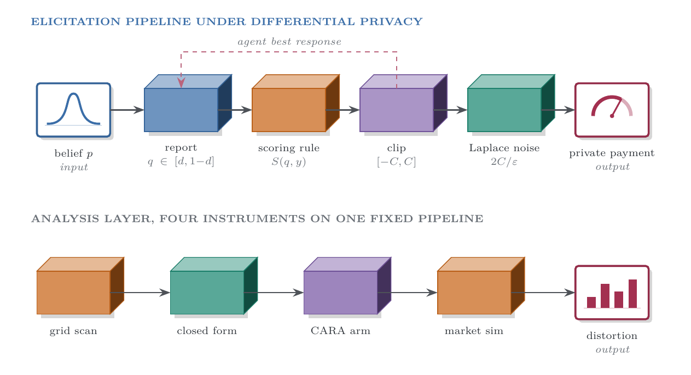
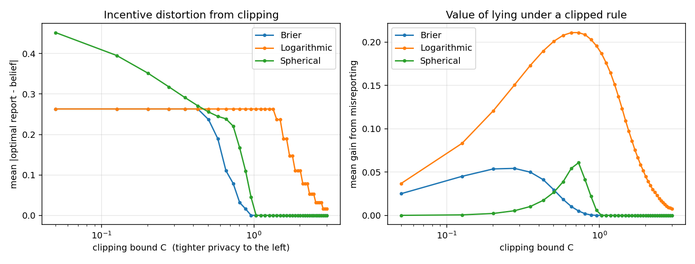

# Clipping, Privacy and Propriety

*What differential privacy costs a proper scoring rule.*

Releasing a forecaster's payment under differential privacy means clipping the
score before noise is added. Clipping is a nonlinear transform of the score
surface, so it can quietly destroy the one property a proper scoring rule exists
to provide. This measures how much it costs, rule by rule.



## The question

A proper scoring rule is built so that reporting your true belief maximises your
expected payment. To release that payment under differential privacy you must
bound the mechanism's sensitivity, and in practice that means clipping the score
into `[-C, C]`. Zero-mean noise added after the clip does not move the argmax, so
the noise preserves propriety. The clip does not: it flattens the score surface,
and a flattened surface can move the optimal report away from the agent's belief.

Nobody appears to quantify that. How badly, and for which rules?

## What it found

**1. Damage is not uniform across rules.** Mean distortion `|optimal report − true belief|`,
averaged over beliefs in [0.05, 0.95]. Zero means propriety is intact.

| clip C | Brier | Logarithmic | Spherical |
|---|---|---|---|
| 0.05 | 0.2631 | 0.2631 | 0.4519 |
| 0.50 | 0.2367 | 0.2631 | 0.2557 |
| **1.00** | **0.0000** | 0.2631 | 0.0447 |
| **2.00** | **0.0000** | 0.1105 | **0.0000** |
| none | 0.0000 | 0.0000 | 0.0000 |

Brier is repaired at `C = 1.0` and spherical at `C = 2.0`, because the clip stops
binding once it exceeds their natural range. The logarithmic rule is still
distorted at `C = 2.0`, which inverts standard practice: the log rule is the
canonical choice in elicitation theory and is the worst choice under privacy.

**2. The sufficient clip is independent of the agent's utility.** `C* = sup|S|`
gives identical distortion under risk-neutral and CARA risk-averse agents at
every `γ` tested, to four decimals. This is forced rather than lucky: a clip that
never binds cannot alter the objective, whatever that objective is. The threshold
is a property of the score function, not of the agent.

**3. That clip is sufficient but not minimal.** Restricting reports to `[d, 1−d]`,
an agent who never claims certainty, yields closed forms verified against a
200,001-point numeric scan to **1.9e−16** relative error: `(1−d)²` for Brier,
`−ln d` for logarithmic, `(1−d)/√((1−d)²+d²)` for spherical. Since Laplace noise
scale is `2C*/ε`, the clip ratio is the noise saving:

| d | Brier | Logarithmic | Spherical |
|---|---|---|---|
| 0.2 | 1.56× | **12.88×** | 1.03× |
| 0.05 | 1.11× | **6.92×** | 1.00× |
| 0.001 | 1.00× | **3.00×** | 1.00× |

Measured incentive cost of that tighter clip, inside the assumed domain, across
three rules and `d ∈ {0.1, 0.02, 0.005}`: **maximum distortion 0.000000**, nine
configurations out of nine. The price falls entirely on agents whose beliefs lie
outside the assumed range, and it is qualitative rather than small: an agent
holding `p = 0.01` is driven to report certainty.

**4. The logarithmic rule has no finite `C*` at all.** A naive scan reports
20.7233. That number is exactly `−ln(1e−9)`, the lower bound of the grid being
scanned, and it tracks the grid perfectly until it hits a second implementation
constant and sticks. The "sensitivity of the logarithmic rule" was two settings
and no mathematics.



## Scope

| | |
|---|---|
| **setting** | binary events, single agent, Laplace mechanism |
| **rules** | Brier, logarithmic, spherical, plus the Beta family |
| **agents** | simulated, risk-neutral and CARA (γ from 0 to 2) |
| **data** | none, this is numerical theory rather than an empirical study |
| **shows** | `C*` is utility-independent, and the minimal clip is domain-dependent and closed-form |
| **does not show** | real forecaster behaviour, multi-outcome events, or that `C*(d)` is minimal rather than merely sufficient |

One caveat worth stating up front: `C*` is **not scale-invariant**. It is a
property of a rule at a chosen payment scale, so cross-rule comparisons are only
meaningful at a fixed scale. Halving the rule halves the clip and halves the
noise, but it also halves every payment, so the agent's signal-to-noise is
unchanged.

## Related work

A literature check found the three threads treated separately and never
combined. [Privacy Games](https://arxiv.org/pdf/1410.1920) models payments
between parties with a proper scoring rule.
[Surrogate Scoring Rules](https://dl.acm.org/doi/10.1145/3565559) handles
elicitation without ground truth. Differential privacy surveys treat clipping as
a sensitivity device and analyse its bias-variance trade-off, not its effect on
truthfulness. No paper was found asking whether the clipping that privacy
requires destroys the propriety the rule exists to provide. That was a
search-level check, not a systematic review.

## Running it

```bash
pip install numpy matplotlib
python experiment.py              # clipping, C*, market sim, risk aversion
python experiment_reachable.py    # the minimal clip over reachable reports
```

| script | runtime | outputs |
|---|---|---|
| `experiment.py` | ~30 s | `results.json`, `figure_distortion.png` |
| `experiment_reachable.py` | ~20 s | `results_reachable.json`, `figure_reachable.png` |

CPU only, no dataset download, no GPU.

## Full write-up

The complete report, with the derivations, the Beta-family sweep and the full
error trail, is in **[report.pdf](report.pdf)**. The architecture diagram is also
available as [architecture.pdf](architecture.pdf). The report’s closing section states the limitations of every result in full.
